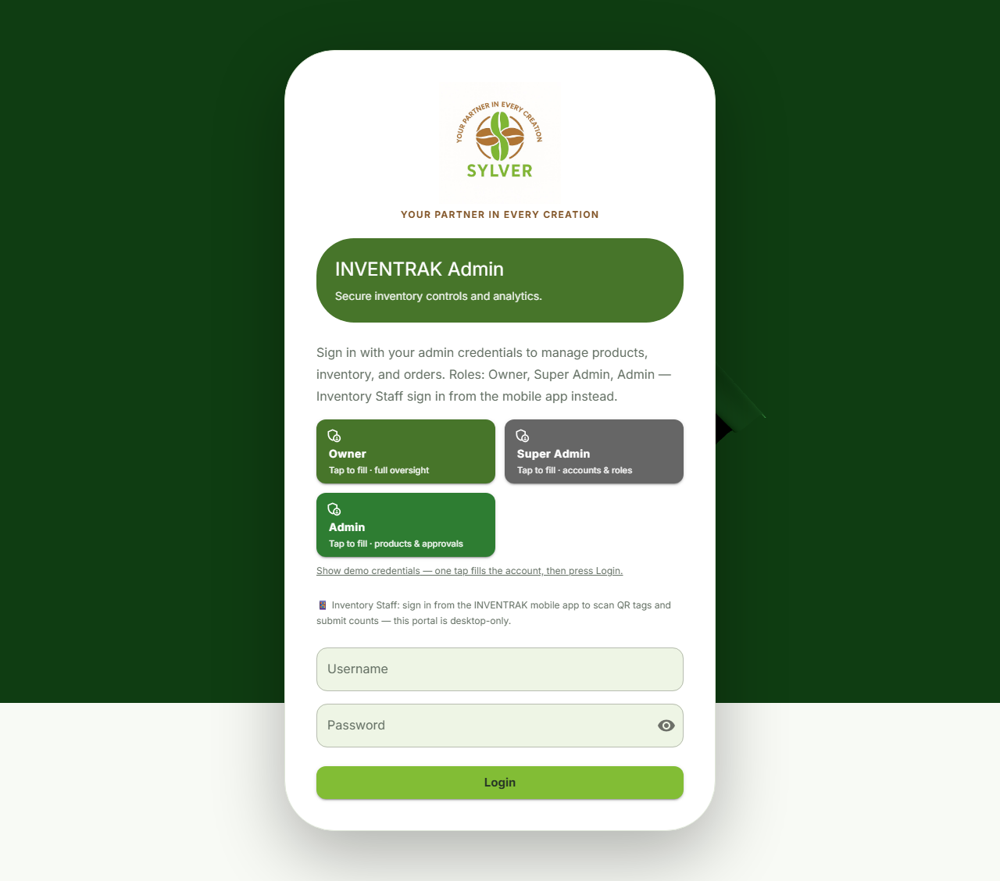
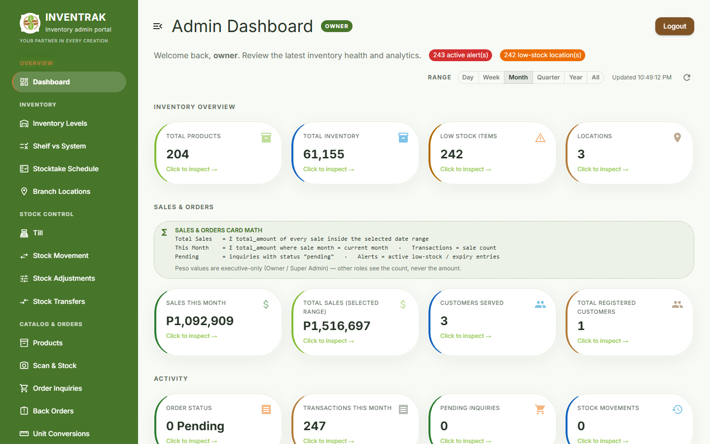

# Sylver branding — palette, logo assets, and where they are used

INVENTRAK is the **software**. **Sylver Restaurant and Coffee Supplies** is the
**partner business** it was built for. Both names appear in the UI and are never
merged: the official lockup carries `SYLVER` + the tagline, the product name
stays `INVENTRAK`.

- **Tagline:** `YOUR PARTNER IN EVERY CREATION`
- **Palette:** sampled from the supplied logo artwork (leaf green, coffee-bean
  brown) plus the cream page the mark sits on.

Nothing in this doc was invented — every hex below is either sampled from the
supplied PNGs or one of the required supporting colours (error red, warning
amber), which are semantic and not part of the brand.

---

## 1. Design tokens (single source of truth)

Each app exports the palette from ONE file. Screens read tokens; they do not
write hex:

| App | File | Exports |
|---|---|---|
| Web admin | `frontend-admin/src/theme.js` | `brand`, `company`, `colors`, `brandSidebar`, `createAppTheme()` |
| Customer app | `mobile-client/src/theme.js` | `brand`, `company`, `colors`, `darkColors` |
| Staff app | `staff-client/src/theme.js` | `brand`, `company`, `colors`, `darkColors` |

| Purpose | Token | Hex |
|---|---|---|
| Primary (Sylver green) | `brand.green` | `#82BD35` |
| Primary dark | `brand.greenDark` | `#47752A` |
| Secondary (Sylver brown) | `brand.brown` | `#B47C3B` |
| Secondary dark | `brand.brownDark` | `#805325` |
| Main background | `brand.background` | `#F8FAF5` |
| Surface | `brand.surface` | `#FFFFFF` |
| Soft accent (light green) | `brand.softAccent` | `#EEF5E5` |
| Primary text | `brand.textPrimary` | `#263326` |
| Secondary text | `brand.textSecondary` | `#647064` |
| Border | `brand.border` | `#DFE7D8` |
| Error / rejected | `brand.error` | `#C62828` |
| Warning / pending | `brand.warning` | `#B26A00` |
| Success / approved | `brand.success` | `#2E7D32` |
| Info | `brand.info` | `#1565C0` |

### Fill vs ink — the one rule that keeps it readable

`#82BD35` is a **light** colour. White text on it is 2.0:1 and unreadable, and
the lime itself is 2.0:1 on white — unusable as text.

- **Fills** use the lime (`#82BD35`): primary buttons, chart series, progress
  dots, active highlights. Text on a lime fill is `#263326` (≈7.6:1).
- **Ink** uses the dark shade (`#47752A`): icons, links, outline borders, small
  labels on light surfaces, sidebar and header backgrounds that carry white
  text (≈5.6:1).
- Anything painted with an *arbitrary* dark role colour must set its own
  light text. See the demo-account tiles on the login page for the comment that
  records that exception.

---

## 2. Logo assets

Supplied artwork (two files, unmodified):

| Asset | Size | Use |
|---|---|---|
| `sylver-symbol.png` | 378×360 | Sidebar rail, small placements, launcher icon source, browser tab icon |
| `sylver-logo.png` | 1024×1024 | Login/welcome, branding sections, structured-data logo |

Committed copies:

```
frontend-admin/public/sylver-symbol.png
frontend-admin/public/sylver-logo.png
mobile-client/assets/sylver-symbol.png
mobile-client/assets/sylver-logo.png
staff-client/assets/sylver-symbol.png
staff-client/assets/sylver-logo.png
```

Launcher icons (`mobile-client/assets/icon.png`, `staff-client/assets/icon.png`,
`adaptive-icon.png`, and the customer app's web `favicon.png`) are the supplied
symbol upscaled with bilinear smoothing onto a white 1024×1024 canvas, occupying
~63% of the frame — standard icon padding. The symbol was **not** redrawn,
recoloured, or cropped.

### Why the logos are not transparent

Both supplied files have an opaque white background. Removing it would eat the
anti-aliased edge of the leaf/bean shapes and damage the mark, so the artwork is
always placed on a **white or cream surface** instead:

- login card (solid white),
- a white chip inside the green sidebar,
- a white chip on the mobile home header and the app login screens.

This is why the sidebar brand mark sits in a rounded white tile rather than
floating directly on the green rail.

---

## 3. Where the branding is applied

| Surface | What was done |
|---|---|
| Web login | Full lockup, company tagline as a brown caption, `INVENTRAK Admin` strip, lime primary button; card is solid white so the artwork blends |
| Web sidebar | Symbol in a white chip, `INVENTRAK`, `Inventory admin portal`, one-line tagline; collapsed rail keeps the symbol (announced as `INVENTRAK`) |
| Customer app login | Symbol on a white chip, `INVENTRAK`, `Customer Portal`, tagline |
| Customer app home | Symbol chip beside the `INVENTRAK` wordmark |
| Staff app login | Real symbol replaces the `▦` placeholder, tagline under the subtitle |
| Icons | Launcher / adaptive / web favicon regenerated from the supplied symbol |
| Loading screen | Both apps' splash now shows the supplied symbol (white background, `contain`) instead of the old `splash.png`; app background colour moved to `#F8FAF5` |
| Charts | Series colours now come from the palette (green, brown, amber, info, error) instead of ad-hoc hexes |
| Metadata | `theme-color`, PWA manifest, structured-data `logo`, and the company name in `index.html` (was "Cafe Supplier", now the official "Coffee Supplies") |

---

## 4. What it looks like

Captured from the running app (Chromium, 1280/1440 wide):





## 5. Known gaps

The two phone apps still render their **dark** palette keys, which are tuned for
the same brand family (green accents on near-black surfaces) but were not
re-sampled from the artwork — there is no dark-mode artwork to sample. If a dark
brand treatment is required, it needs an approved dark lockup.

The web console has no About page, so the "company branding section" use of the
full lockup is the login screen only. The splash/loading surfaces on the phones
are branded; the web app has no loading screen to brand.
